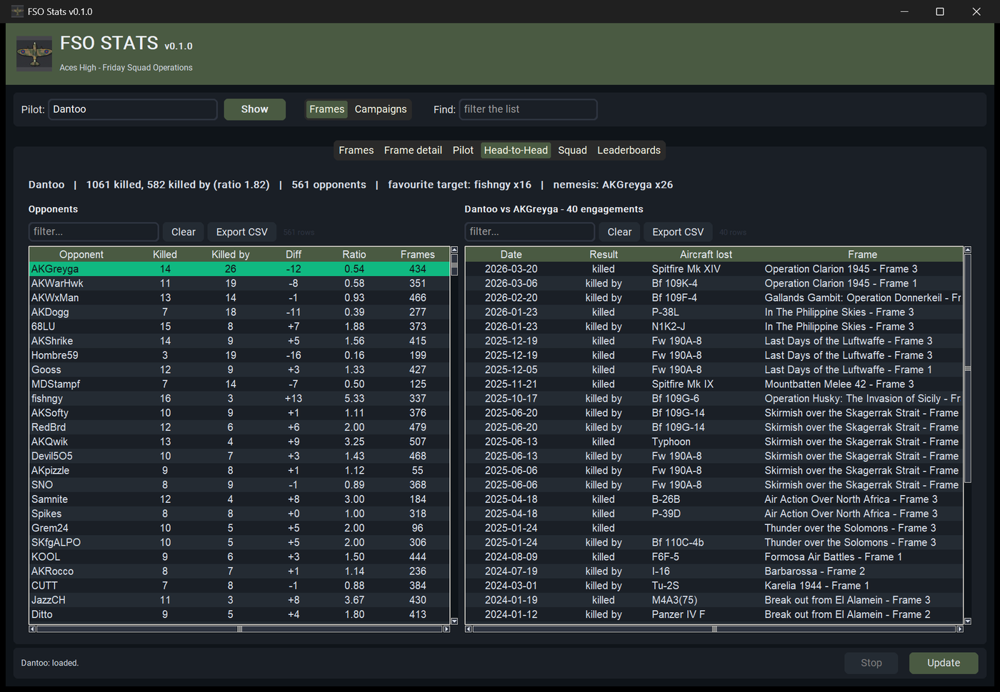
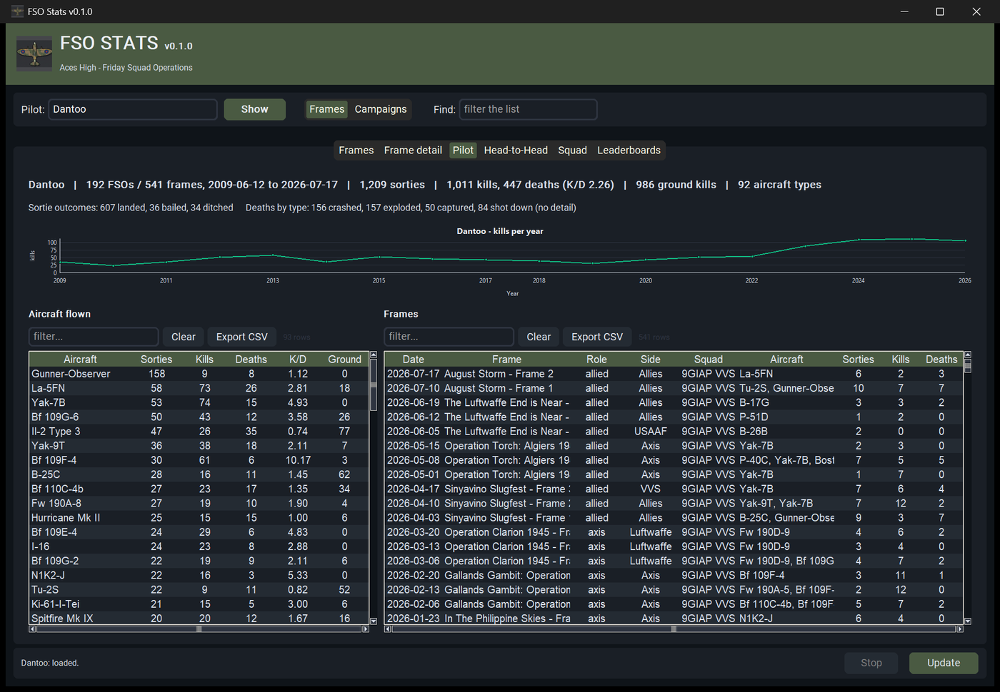
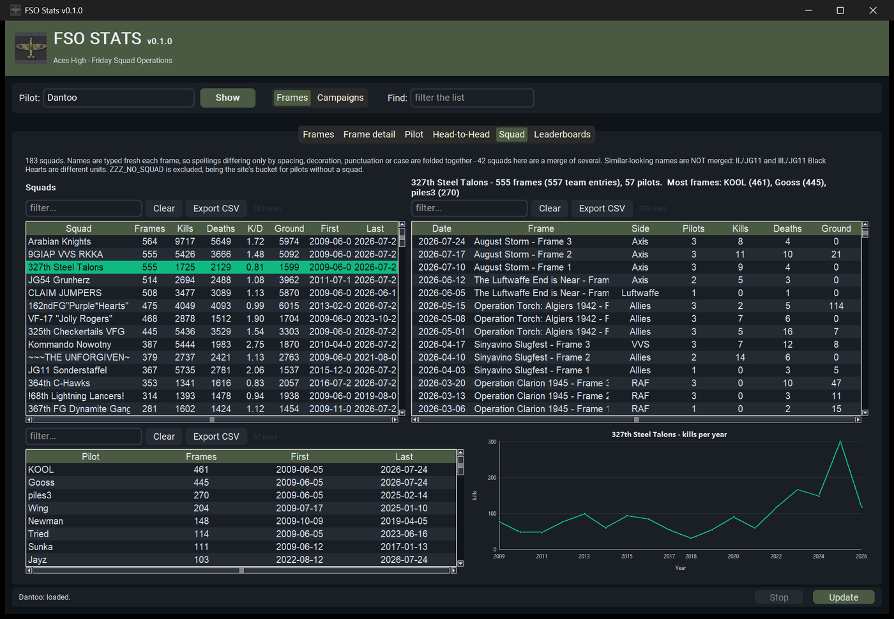
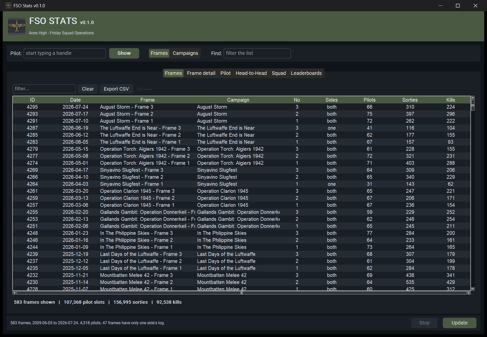
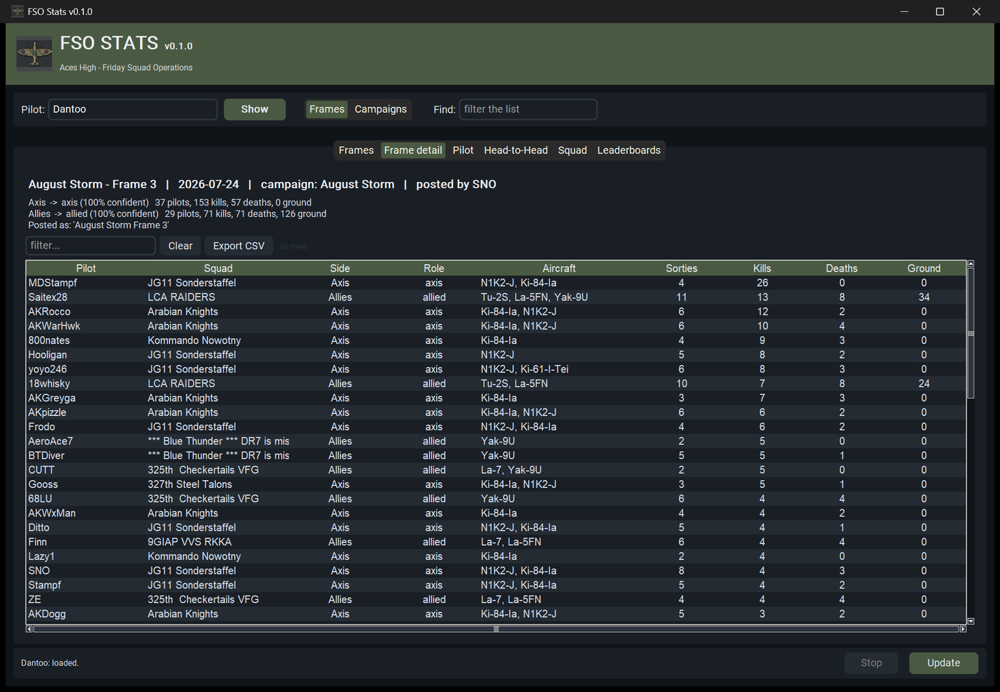
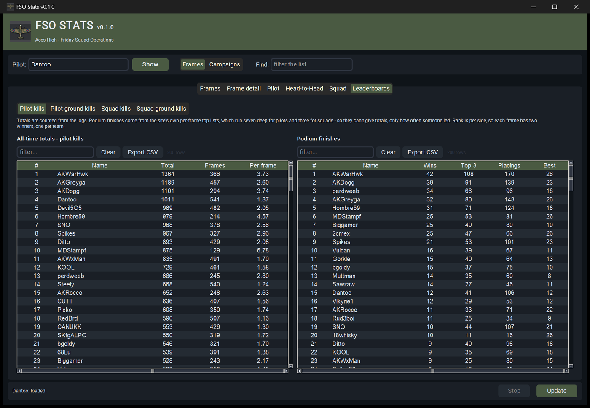

# FSO Stats

Browse **Aces High Friday Squad Operations** statistics — 18 years of
them, from 2009 to today.

FSO logs live on [ahevents.net](http://ahevents.net) one frame at a
time. This scrapes them into a local SQLite database and puts a desktop
app on top, so a pilot's career, a squad's history, or a personal
record against one opponent is a couple of clicks rather than an
afternoon of reading log pages.

It's a companion to [AHStats](https://github.com/steelington/AHStats),
which does the same for main-arena tour statistics, and shares its
palette and grid components.

## Head-to-head

The reason this exists. An FSO log names both parties on every
shootdown, so a pilot's record against any individual opponent is
recoverable — across all eighteen years.



Pick an opponent and every engagement between the two is listed: which
way it went, in which frame, and what was lost.

## Everything else

**Pilot** — career totals, aircraft flown with a real per-type K/D,
every frame flown, and a kills-per-year trend.



**Squad** — totals, roster, frame-by-frame history and a trend of its
own.



**Frames and campaigns** — 583 frames grouped into 201 campaigns,
switchable, with the site's inconsistent titles corrected.



**Frame detail** — both teams, the side each actually fought for, and
every pilot's result.



**Leaderboards** — all-time totals beside podium finishes, for pilots
and squads.



Every grid sorts, filters and exports to CSV. Hovering a column heading
explains what it counts, which matters more here than in most apps —
see the caveats below.

## Running it

**Use the exe.** Download `FSOStats.exe` from the releases page — it
ships with all 583 frames already scraped. The first launch unpacks the
database into `%LOCALAPPDATA%\FSOStats` and takes about five seconds;
after that it opens straight away. **Update** fetches whatever has been
posted since.

That really is the recommended route, and the next section explains
why.

## Running from source

> **The database is not in this repository**, and there is no quick way
> to get one. A fresh clone starts with nothing and has to scrape all
> ~660 event pages from ahevents.net. The client waits 3 seconds
> between requests per worker and runs 3 workers, and the site itself
> takes about nine seconds to answer, so **expect somewhere between
> half an hour and an hour** before you can use the app. It is a small
> community site; please don't speed it up.
>
> If you only want to *use* FSO Stats, download the exe instead. Source
> is for hacking on it.

```
pip install -r requirements.txt
python scrape_fso.py --all        # ~30-60 minutes, once
python app.py
```

`scrape_fso.py` is resumable, so an interrupted run picks up where it
stopped — nothing already fetched is requested twice. Without `--all`
it only looks for frames newer than `SCRAPE_SINCE`, which is what the
Update button does; a fresh clone needs `--all` to get the history.

The app will start without a database, but every view will be empty and
it will tell you so.

## Building the exe

Needs a populated `fsostats.db` first — see above.

```
python -m fsostats.prepare_db      # VACUUM, drop indexes, gzip
pyinstaller FSOStats.spec --clean  # -> dist/FSOStats.exe
```

`prepare_db` drops the indexes before compressing — they're more than
half the file, and the app rebuilds them on first open in about two
seconds. That takes the shipped database from 37 MB to 18.6 MB.

The prepared `fsostats/data/fsostats.db.gz` is a build artefact and is
deliberately **not** committed: it would add another 18 MB to the
repository's history on every rebuild, and it can always be regenerated.
It belongs with the exe as a release asset.

## Things the data does, that you'd want to know

The log is a community record kept by hand for eighteen years, and it
shows. The app surfaces these rather than hiding them:

- **A kill entry names the *victim's* aircraft**, not the killer's. Per
  aircraft statistics are recovered by matching each entry to the
  sortie it fell within.
- **A shootdown is written twice**, once per side. Counting both would
  double-count 46,586 of them.
- **73 events have no logs at all** — the site fails to render them,
  and has since around 2013.
- **47 frames hold only one team's log.** The other was never posted.
- **Side labels can't be trusted** — themed names, and a few frames
  labelled backwards — so the side each team actually fought for is
  inferred from the aircraft it flew, at 97.9% accuracy.
- **Titles and squad names drift** between frames. Both are normalised,
  and 53 frames are corrected by hand where no rule could.

`FINDINGS.md` documents all of it, with the evidence.

## Testing

```
pytest tests
```

112 tests: unit tests against a toy database with known answers, plus
integration checks asserting invariants on the real one.

## Licence and courtesy

The scraper waits three seconds between requests and runs three workers.
ahevents.net is a small community site run by volunteers — please don't
raise those numbers.
